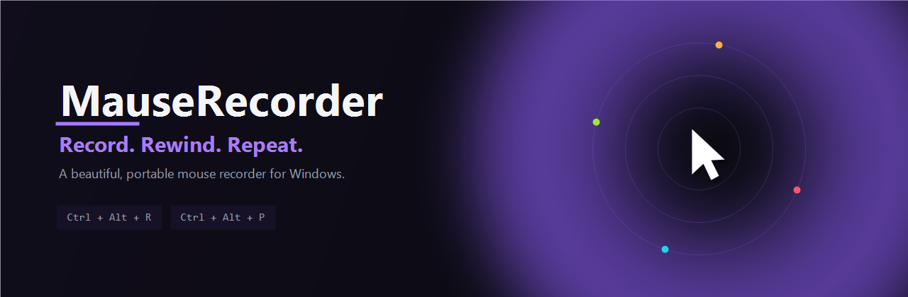
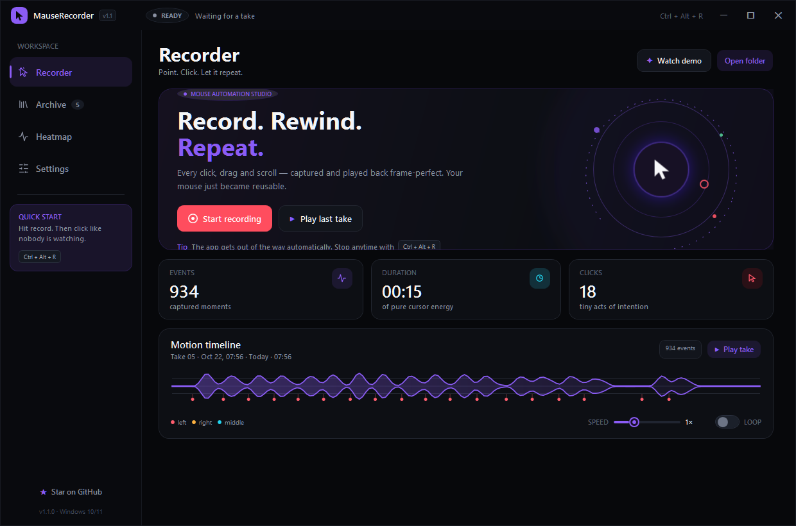
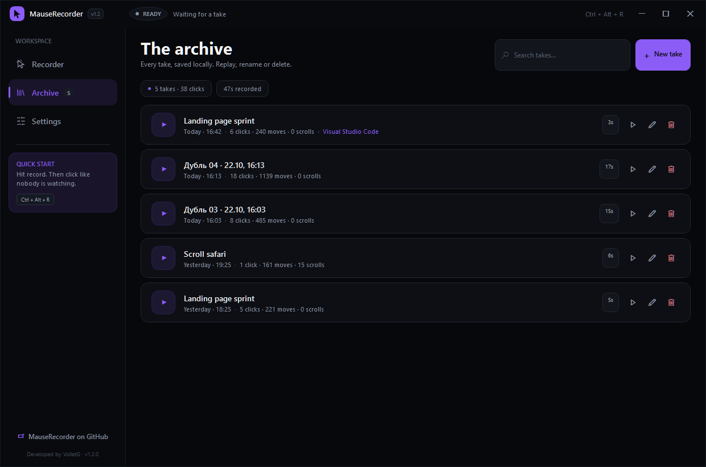
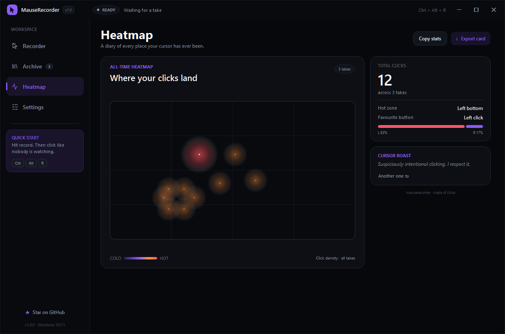
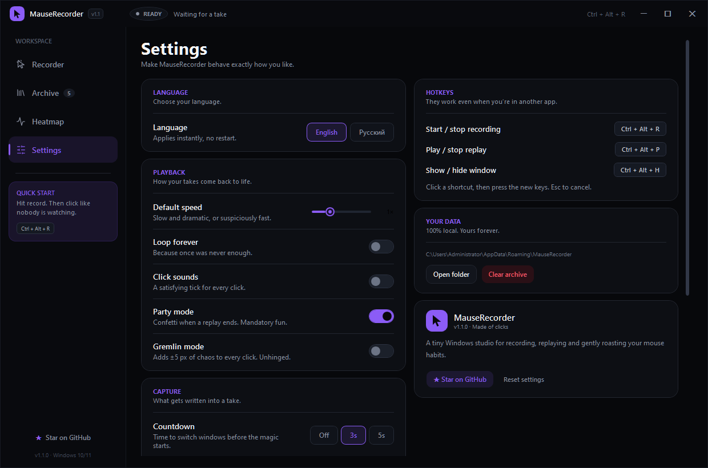
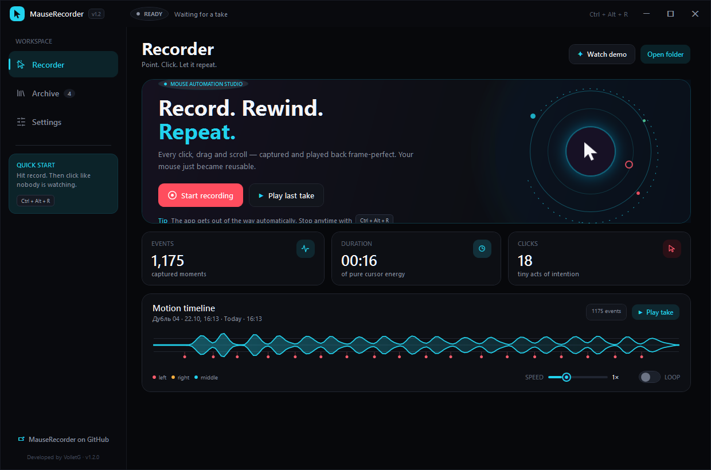
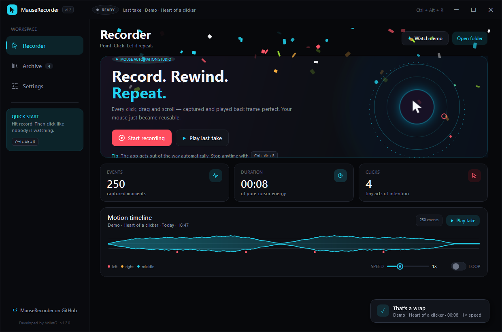
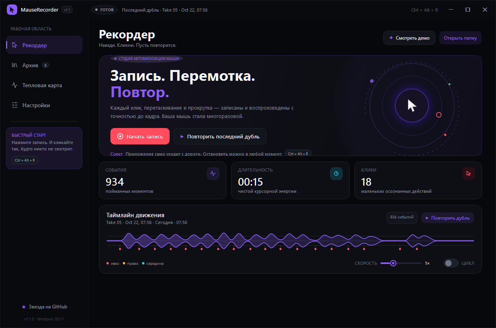
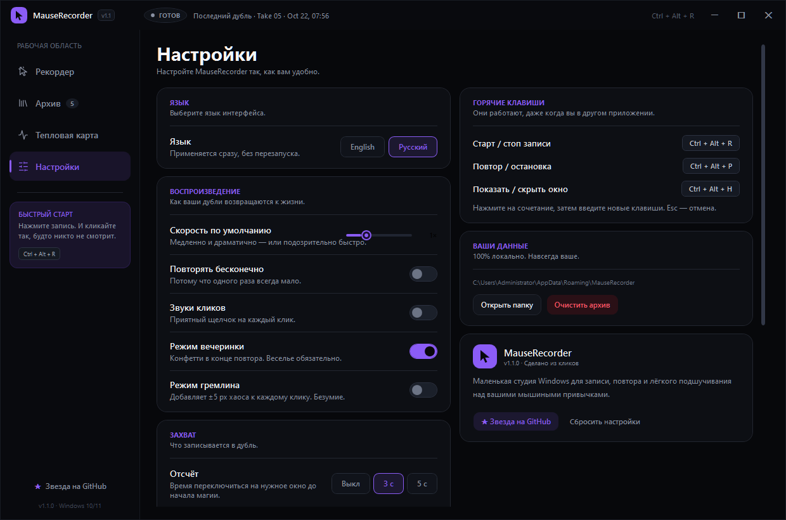

<div align="center">



# MauseRecorder

**A beautiful, portable mouse recorder for Windows.**
Capture every click, drag and scroll — then replay them frame-perfect. 🖱️✨

[](#-download)
[](#-build-from-source)
[](LICENSE)
[](#)

</div>

---

MauseRecorder is a tiny Windows studio for recording and replaying your mouse. Point, click, hit record — the app saves the exact rhythm of your cursor, then plays it back on demand. It is **100% local**, has **zero dependencies**, and looks good doing it.

> Why "Mause"? Because a mouse should be able to make a typo too. 🐭

## ✨ Features

**Recording & playback**
- 🎬 Records moves, left / right / middle / X-button clicks and wheel scrolls
- ⚡ Frame-accurate `SendInput` playback with speed control (0.25× → 5×)
- 🔁 Loop mode for replays that never stop
- ⏱️ Optional countdown before recording starts (so you can switch windows)
- 🧪 **Watch demo** — instantly replays a heart-shaped cursor path, no recording needed

**The pretty part**
- 🌑 A deep-black, frameless UI with a hand-crafted dark theme
- 🎨 Four accent palettes — **Violet, Cyan, Lime, Sunset** — that repaint the whole app instantly
- 📈 Live **motion timeline** with a waveform and click markers
- 🗺️ All-time **click heatmap** of everywhere your cursor has ever been
- 🖼️ One-click **export** of your stats/heatmap as a shareable PNG card

**The fun part**
- 🎉 **Party mode** — confetti when a replay finishes
- 👹 **Gremlin mode** — adds ±5 px of chaos to every click
- 🏆 **Achievements** ("Click Goblin", "Marathon Mouse", "Scroll Lord"…)
- 😏 **Cursor roasts** — the app gently judges your mouse habits
- 🔊 Optional click sounds, plus a floating recording HUD

**Quality of life**
- ⌨️ Global hotkeys that work from any app — and you can rebind them
- 🌍 English and Русский, switchable in Settings without a restart
- 📦 Single portable `.exe`, no installer, no admin rights
- 💾 Recordings are small human-readable `.mrec` (JSON) files

## 📸 Screenshots

| Recorder | Archive |
| :---: | :---: |
|  |  |

| Heatmap | Settings |
| :---: | :---: |
|  |  |

| Accent themes | Party mode 🎉 |
| :---: | :---: |
|  |  |

| Recorder (Русский) | Settings (Русский) |
| :---: | :---: |
|  |  |

## ⬇️ Download

Grab the latest `MauseRecorder-win-x64.zip` from the [**Releases**](../../releases) page, unzip it anywhere and run `MauseRecorder.exe`. That's it — it's fully self-contained, so you don't even need .NET installed.

> **Unsigned build:** MauseRecorder is a free, community-built app and the binary is **not code-signed**. Windows may therefore show **"Unknown publisher"** ("Не удается проверить издателя / Неизвестный издатель") the first time you run it. This is expected — click **More info → Run anyway** (**Подробнее → Выполнить в любом случае**). The full source is right here, so you can also build it yourself.

## 🎮 How to use

1. Hit **Start recording** (or press <kbd>Ctrl</kbd>+<kbd>Alt</kbd>+<kbd>R</kbd>).
2. Do your thing with the mouse.
3. Press <kbd>Ctrl</kbd>+<kbd>Alt</kbd>+<kbd>R</kbd> again to stop — the take is saved automatically.
4. Select it in the **Archive** and hit replay, or bind a favourite from the Recorder page.

### Hotkeys

| Shortcut | Action |
| :--- | :--- |
| <kbd>Ctrl</kbd> + <kbd>Alt</kbd> + <kbd>R</kbd> | Start / stop recording |
| <kbd>Ctrl</kbd> + <kbd>Alt</kbd> + <kbd>P</kbd> | Play / stop replay |
| <kbd>Ctrl</kbd> + <kbd>Alt</kbd> + <kbd>H</kbd> | Show / hide the window |

> Hotkeys are registered globally. If another app already owns them, MauseRecorder shows a friendly toast and the on-screen buttons keep working.
>
> **Want different keys?** Open **Settings → Hotkeys**, click a shortcut and press your new combination (for example <kbd>Ctrl</kbd>+<kbd>Shift</kbd>+<kbd>K</kbd>). Press <kbd>Esc</kbd> to cancel. Changes apply instantly and are saved.

## 🔒 Your data

Everything stays on your machine — there is no telemetry, no network calls, no accounts.

| What | Where |
| :--- | :--- |
| Recordings | `%APPDATA%\MauseRecorder\recordings\*.mrec` |
| Settings | `%APPDATA%\MauseRecorder\settings.json` |

`.mrec` files are plain, indented JSON, so you can diff them, edit them, or even hand-craft a take.

<details>
<summary>Example take (click to expand)</summary>

```json
{
  "id": "8f3c1a2b4d5e6f70",
  "name": "Landing page sprint",
  "createdAt": "2026-10-21T18:25:00",
  "durationMs": 5120,
  "screenLeft": 0, "screenTop": 0, "screenWidth": 1920, "screenHeight": 1080,
  "events": [
    { "time": 0.0, "x": 812, "y": 540, "type": "Move" },
    { "time": 42.5, "x": 900, "y": 512, "type": "LeftDown" },
    { "time": 88.1, "x": 900, "y": 512, "type": "LeftUp" }
  ]
}
```

</details>

## 🛠️ Build from source

**Requirements:** Windows 10/11, [.NET SDK 10](https://dotnet.microsoft.com/download).

```powershell
git clone https://github.com/VolletG/MauseRecorder.git
cd MauseRecorder
dotnet run
```

### Publish a portable single-file build

```powershell
dotnet publish -c Release -r win-x64
```

The self-contained `.exe` lands in `bin\Release\net10.0-windows\win-x64\publish\`.

## 🧱 How it works

| Piece | Role |
| :--- | :--- |
| `Services/MouseHook.cs` | Low-level `WH_MOUSE_LL` global hook |
| `Services/RecorderService.cs` | Turns raw hook events into a `Recording` (ignores injected input & the app's own window) |
| `Services/PlaybackService.cs` | Replays a take with `SendInput` on absolute virtual-desktop coordinates |
| `Services/StorageService.cs` | Atomic JSON persistence in `%APPDATA%` |
| `Controls/TimelineControl.cs` | Custom waveform + click-marker renderer |
| `Controls/HeatmapControl.cs` | Custom click-heatmap renderer |
| `Themes/DarkTheme.xaml` | Every dark style, control template and accent resource |

Two details worth calling out:

- **Injected events are ignored.** The recorder skips anything flagged `LLMHF_INJECTED`, so a replay never records itself.
- **Its own window is ignored too.** Clicks on the stop button (matched by window handle → process id) are filtered out, so your takes stay clean.

## 📁 Project structure

```
MauseRecorder/
├─ Controls/     # custom timeline & heatmap renderers
├─ Interop/      # P/Invoke declarations
├─ Models/       # Recording, MouseEvent, AppSettings
├─ Services/     # hook, recorder, playback, storage, sounds, themes
├─ Themes/       # DarkTheme.xaml (styles + accents)
├─ Windows/      # Overlay HUD, countdown, dialogs
├─ Assets/       # icon + generators
├─ docs/         # banner & screenshots
├─ MainWindow.xaml(.cs)
└─ MauseRecorder.csproj
```

## 🤝 Contributing

Pull requests are welcome — see [CONTRIBUTING.md](CONTRIBUTING.md). Ideas, bug reports and screenshots of your best cursor art are all appreciated.

## 📄 License

[MIT](LICENSE) © MauseRecorder contributors

---

<div align="center">

### 🇷🇺 По-русски

**MauseRecorder** — красивый портативный рекордер мыши для Windows. Пишет клики, перетаскивания и прокрутку, а потом воспроизводит их с точностью до кадра.

- 🎬 Запись движений, кликов (левая / правая / средняя / боковые) и прокрутки
- ⚡ Воспроизведение со скоростью от 0.25× до 5× и режимом повтора
- 🎨 Четыре акцентных темы: фиолетовая, голубая, лайм и закат
- 📈 Живой таймлайн движений и 🗺️ тепловая карта кликов
- 🖼️ Экспорт статистики в PNG-карточку
- 🎉 Режим вечеринки (конфетти), 👹 режим гремлина, 🏆 достижения и 😏 «прожарка» курсора
- 🌍 Два языка интерфейса — **English** и **Русский**; переключаются в настройках без перезапуска
- ⌨️ Глобальные горячие клавиши: по умолчанию <kbd>Ctrl</kbd>+<kbd>Alt</kbd>+<kbd>R</kbd> — запись, <kbd>Ctrl</kbd>+<kbd>Alt</kbd>+<kbd>P</kbd> — повтор, <kbd>Ctrl</kbd>+<kbd>Alt</kbd>+<kbd>H</kbd> — окно. Любую комбинацию можно переназначить в **Настройки → Горячие клавиши**
- 🔒 Всё локально: `%APPDATA%\MauseRecorder`, без телеметрии и без сети

**Установка:** скачайте `MauseRecorder-win-x64.zip` из раздела [Releases](../../releases), распакуйте и запустите `MauseRecorder.exe`. Установка не нужна — .NET внутри.

> **Сборка без подписи:** приложение не подписано код-сертификатом, поэтому Windows может показать «Издатель: Неизвестный издатель». Это нормально — нажмите **«Подробнее» → «Выполнить в любом случае»**. Либо соберите сами из исходников.

Сделано с любовью к курсору. 🖱️

</div>
